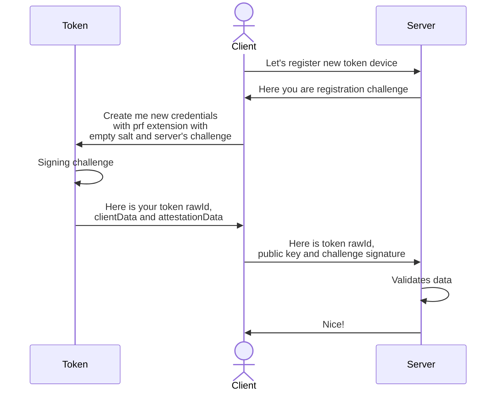
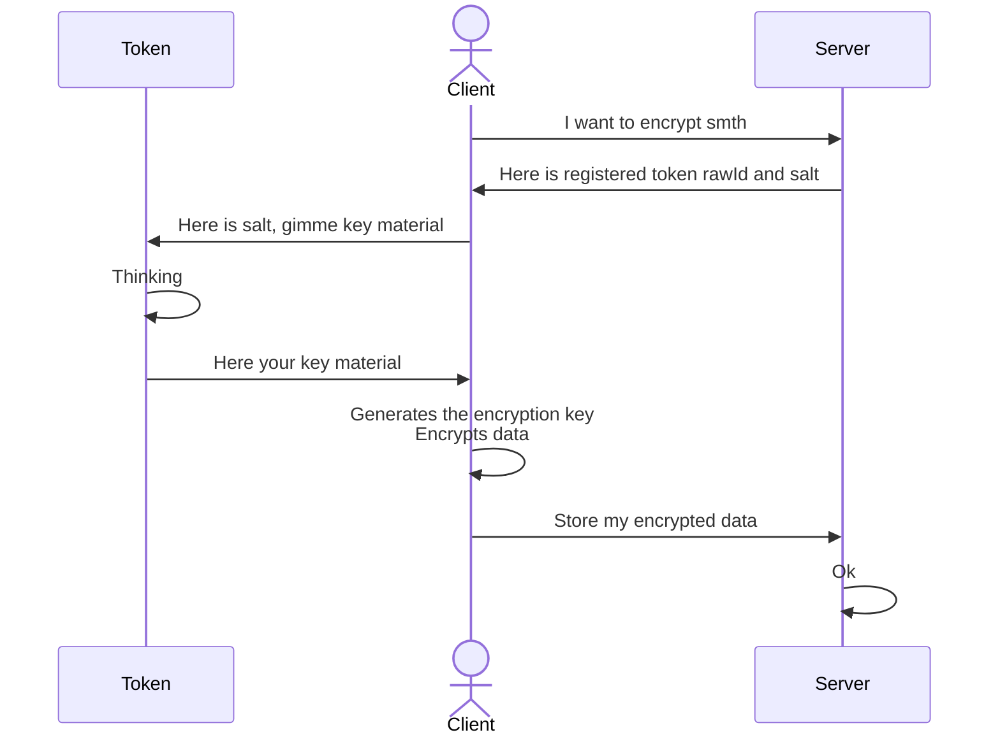
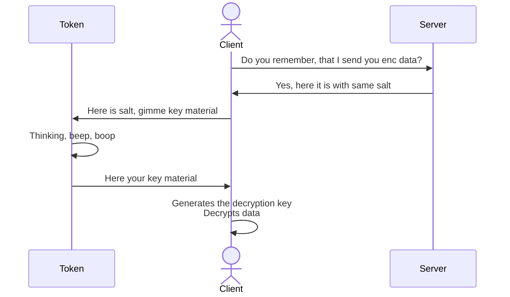

## Intro

In 2023 long-waited [`prf`](https://github.com/w3c/webauthn/wiki/Explainer:-PRF-extension) extension was finally released for Webauthn, which allows us to generate the encryption key using almost any Webauthn compatible chip. Here I want to describe as simple as possible how the whole process works from a top-level abstraction perspective.

Demo TS code and react app, that covers this post you can find [here](https://pltanton.github.io/webauthn-hmac-secret-demo/) and source code in [github](https://github.com/pltanton/webauthn-hmac-secret-demo/).
  
Long story short the whole process can be simplified by several steps:

1. Regular token registration
2. Authentication with the device for following encryption key generation, using server-provided salt 
3. Client data encryption
4. ...
5. Authentication with the device for following decryption key generation, using server-provided salt
6. Decryptioning of previously encrypted data

Let's dive into each step:

### Token registration

This process is not much different than regular webauthn device registration by `navigator.credentials.create` method. The only thing we do is to check additionally if the device and browser support require PRF extension. We will receive results from the PRF extension, but it is not reliable for key generation on the registration step. 

NOTE! We should provide salt for the PRF extension on the registration step, but it does not matter what this salt is, only the correct format matters.

### Authentication and encryption key generation

Here we do `navigator.credentials.get` method with server-generated salt. We should use the same salt to generate a decryption token later, so it must stored securely on the server side. Like in the registration step we will use the PRF extension, but this time result of the extension should provide us a key data in raw format, that we will pass to [`SubtleCrypto.importKey()`](https://developer.mozilla.org/en-US/docs/Web/API/SubtleCrypto/importKey) method. This key is used with [HKDF](https://datatracker.ietf.org/doc/html/rfc5869) algorithm. At this point we should have a derivationKey, instead, we can directly generate encryption/decryption key if we are not interested in additional KDF security.

### Client data encryption

Now we will use [`SubtleCrypto: deriveKey()`](https://developer.mozilla.org/en-US/docs/Web/API/SubtleCrypto/deriveKey) method to generate the encryption key from the key material generated in the previous step. Or use the encryption key if we choose not to generate HDKF material. Then we will be able to encrypt some data.

### Authentication for decryption and decryption

These two steps are the same as the previous two, the only difference is that we will make a decryption key instead of an encryption one.

## Conclusion

Such technology gives us a lot of possibilities in the matter of client data protection. It can cover cases like:

- Protection of client-sensitive data on the client side to store it on the service
- Full cookies or local storage encryption
- Sharing protected data with 3rd parties for further extraction/validation

## Diagrams

A bit more detailed diagram of process:

#### Registration

#### Encryption

#### Decryption

## Reference

- https://blog.millerti.me/2023/01/22/encrypting-data-in-the-browser-using-webauthn/ good example of implementation
- https://levischuck.com/blog/2023-02-prf-webauthn another example with built-in demo and detailed explanation